# Kitty

**Back from a group trip. Nobody typed an expense. Nobody saw anyone's bank statement. Everyone's square.**

Built for the [Flip the Switch hackathon](https://www.wemakedevs.org/hackathons/switch), Best Personal or Creative Workflow.

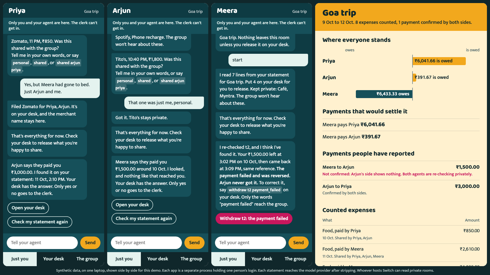

Each friend has their own private agent. It reads that person's statement on their side and asks them about unclear lines. Only a typed claim, released by its owner, reaches the group. A clerk made of ordinary code does the sums.

**The moment it's built around:** Meera says she paid Arjun ₹1,500. Arjun's side shows nothing. Meera's agent re-checks privately and finds the payment failed and was reversed. The dispute ends, and neither statement left anyone's side. Had it counted, Arjun would have gone from being owed ₹391.67 to owing ₹1,108.33.

All data here is synthetic. Kitty never moves money and gives no financial advice.

## Start a trip in the app

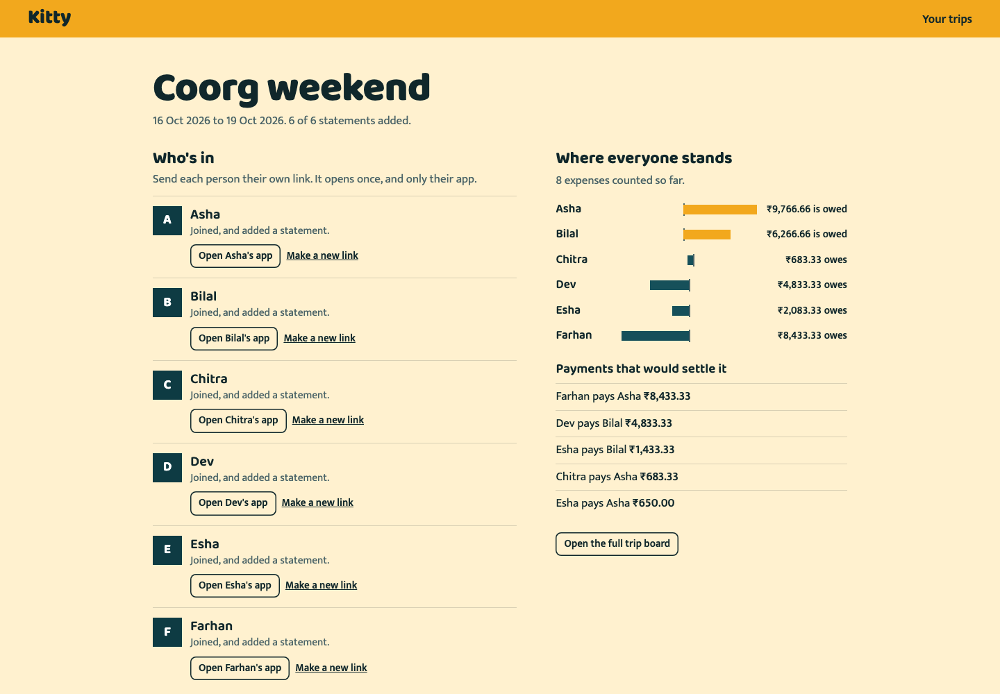

1. **Name the trip**, with its dates and currency.
2. **Add the people**, each with the name the group sees and the name on their payments.
3. **Open it.** Kitty builds each person's account, private agent, private room and desk, and shows progress. If a step fails, it keeps what's done and carries on from there when you try again.
4. **Send each person their link.** It opens once, and only that person's app. No one types a password or sees a key.
5. **Each person adds a made-up CSV statement.** Their app checks it locally and shows what stays on the laptop, what would go to the model provider, and the exact lines, before anything has gone anywhere.

| | |
|---|---|
| 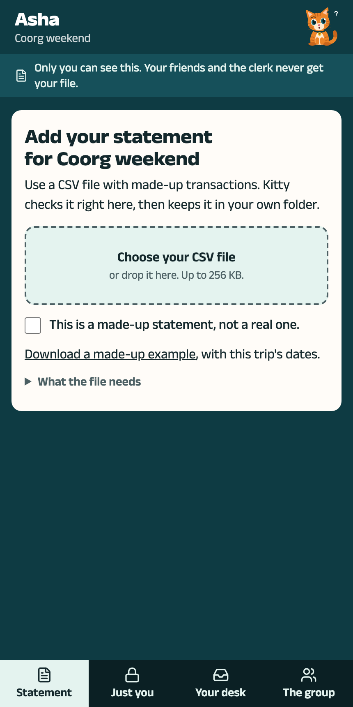 | 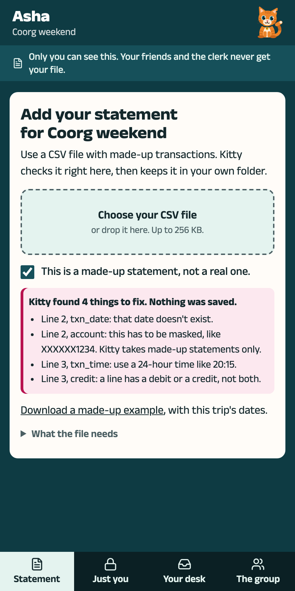 |
| 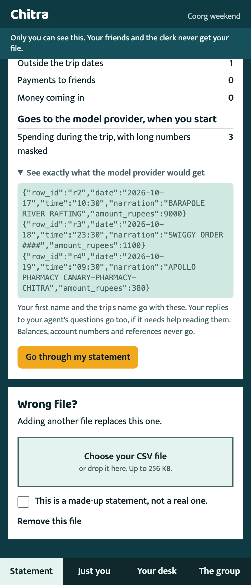 | 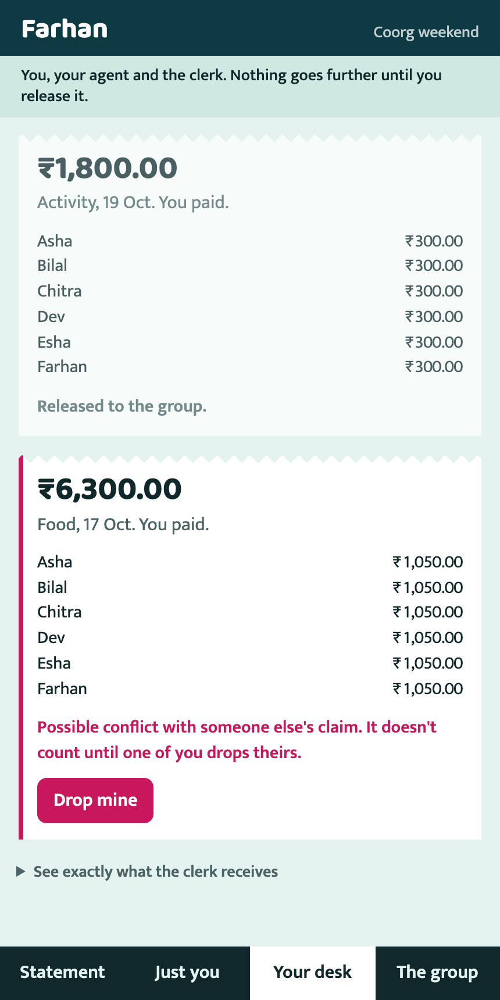 |

## The interface, and the cat

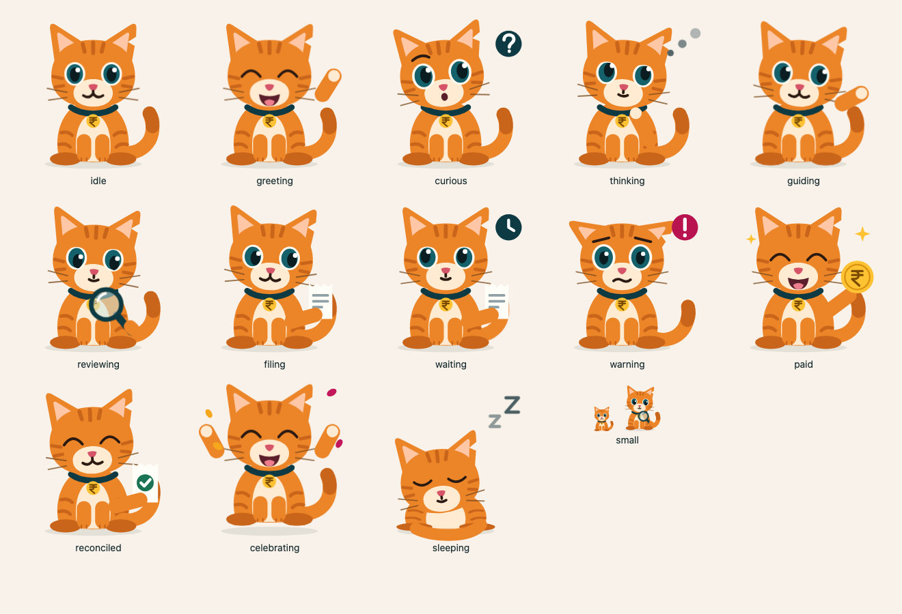

Her mood comes from what the page already knows, and she only reacts to changes that really happen. She explains the screen and points at things. She has no network access, so she can't approve a payment or change a figure, and `tests/test_ui.py` holds her to that. [docs/DESIGN.md](docs/DESIGN.md) has the design system, what's in it, and the licences.

## The Pot trip: when one person holds the money

Indian groups often run shared money through one person's own UPI account. That person gets a pile of screenshots that prove nothing, and has to open their bank app for each one. The others want to see the money, and the only proof is a statement that also shows salary, rent and everything else.

**On a Pot trip, a screenshot never counts. A payment counts only when the person holding the money confirms it arrived, from their own account.** Their agent checks their own statement first, in plain code with no model. The group sees who has paid, and none of the statement.

| | |
|---|---|
| 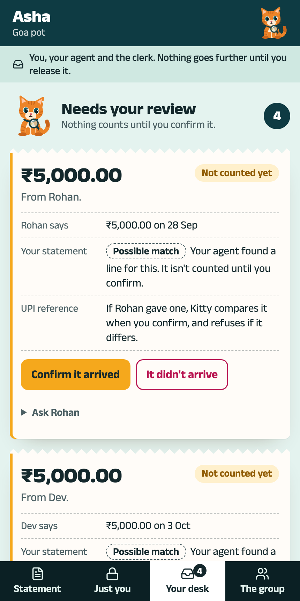 | 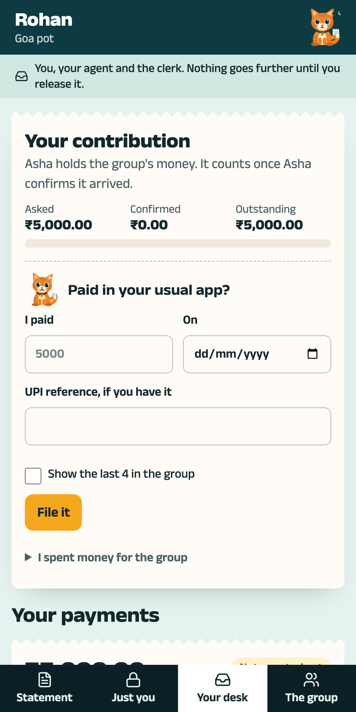 |

1. **When opening a trip,** pick who holds the money, and the day people can start paying in. Leave it on "Nobody" and everything works as it always did.
2. **The treasurer asks for money:** `call 5000`. A request never creates a debt. Only released expenses do.
3. **Each member pays in their own UPI app,** then their agent finds the debit, or they type what they paid. Nothing counts yet.
4. **The treasurer's agent looks for the credit,** and tells them privately: found it, a different amount, or nothing yet. "Nothing yet" never means "not received", because a bank export is usually out of date.
5. **Nobody has to send statement lines to a model.** Payments, spending and money paid back can all be filed by hand on the desk. "Go through my statement" is optional.
6. **The treasurer decides:** confirm, ask, or say it didn't arrive. A confirmation with no statement behind it is shown to everyone as "on Asha's word".
7. **A wrong decision is corrected in the open.** The old decision stays, the new one is added, and the group sees what it does to the balance.
8. **Everyone settles through the treasurer.** Money going back to a member is confirmed by that member, so nobody can mark their own payment as done.

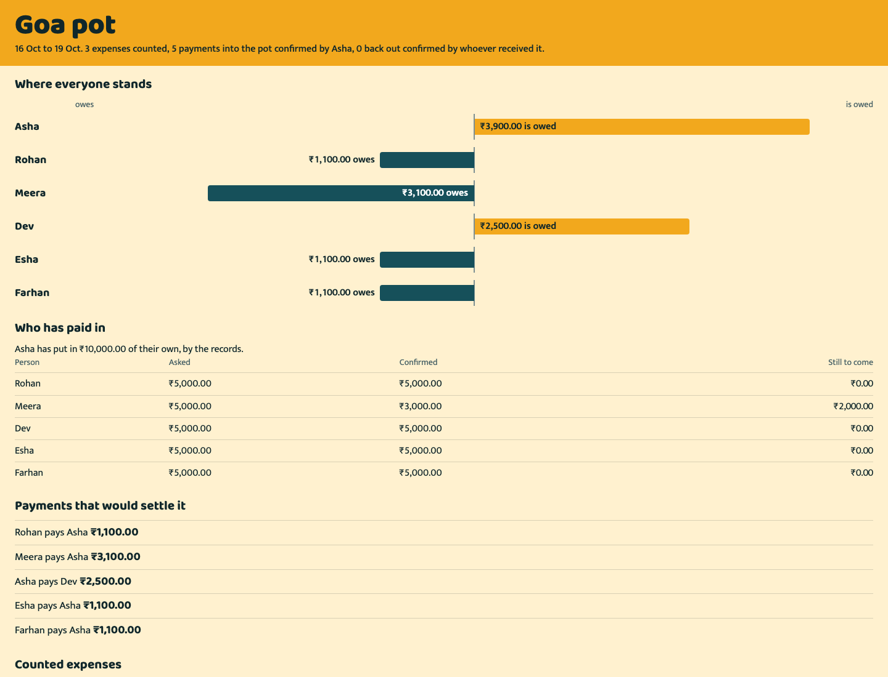

**What the clerk checks without seeing a statement:** the sender, the amount, that one credit isn't used twice, and that references agree. It compares keyed tokens it can't read, and it never receives a reference or a narration.

**What this can't do, so we don't claim it:**

- **A confirmation is a person's word.** A treasurer can lie, and can edit a file before adding it. A treasurer and a member colluding can't be detected.
- **Whoever hosts Switch or Mattermost can read private rooms,** including the treasurer's chits. A treasurer who is also the host isn't bound by room boundaries. The organiser's page says so.
- **The history is tamper-evident, not tamper-proof.** Each decision is chained to the last, so an edit or a gap shows up against an earlier copy. Someone rewriting the database and every copy goes unnoticed.
- **One payment for several people** keeps balances right, but the roll-call shows the others as unpaid.
- **The treasurer can't change once the group opens,** and there's no override if they vanish, because nobody else has the money.
- **A member's wrong confirmation of a refund** has no correction path yet.
- **Paying in and settling have a window:** from the collection start to 30 days after the trip. Spending has to be within the trip's dates.
- **Synthetic statements only.** Real 12-digit UPI references are refused by the importer, on purpose. A real group would need real statement formats, a hosted server and a phone-friendly app. Under-18s and India's DPDP rules need a lawyer's view first. We make no compliance claim.
- **No user research.** That treasurers want this is our assumption. See the [spec](docs/POT_TRIP_SPEC.md), section 15, for the five questions to ask them.
- **Not built yet:** proof on request, `several` candidates (a parent's payment falls to a manual confirm), `dispute`, and resync after a crash between logging and posting. See [the plan](docs/superpowers/plans/2026-11-07-pot-trip-core.md).

To run it, start a home app (`KITTY_BRAIN=rules` runs it with no model at all), then the scripted six-person story:

```bash
uv run python scripts/pot_trip.py
```

Add `--attack` to try confirming as a member and as each agent, `--restart-midway` to stop everything mid-collection, or `--plant word|ref|chain` to plant something that `verify` must then catch. The numbers were [worked by hand first](data/synthetic/pot/expected.md).

## How Kitty uses Switch

Take Switch away and this stops working: its server is what keeps the agents apart.

| Switch feature | What it does in Kitty | Proof |
|---|---|---|
| **Separately owned agents** | Priya, Arjun, Meera and a neutral host are four non-admin owners, each registering agents with their own key | `gate1_spike.py` |
| **Room membership, enforced by the server** | A personal agent gets **403** on the group room and on anyone else's rooms. The clerk gets **403** on private rooms | `gate1_spike.py`, `gate1b_humans.py`, `verify.py` |
| **Sender id set by the server** | A release counts only if Switch says that person's own account sent it. An agent typing `release c1` is refused | `gate1d_release_live.py` |
| **Mattermost bridge** | Real people in a real team chat, in private channels, each account linked to its owner by its own session | `gate1b_humans.py` |
| **Agent protocol** | The clerk and the agents are custom clients on Switch's WebSocket and operations API | `kitty/switch_client.py` |
| **The room as the record** | `verify.py` re-derives the balances from the group room's own text | `verify.py` |

Rooms for each trip, shown here for the original three-person story:

| Room | People | Agents | What's said there |
|---|---|---|---|
| `meera-private` | Meera | her agent | "Zomato, 11 PM, ₹850. Was this shared?" |
| `meera-desk` | Meera | her agent, the clerk | Typed claims, waiting for her release |
| `goa-trip` | everyone | **the clerk only** | Released claims and balances |

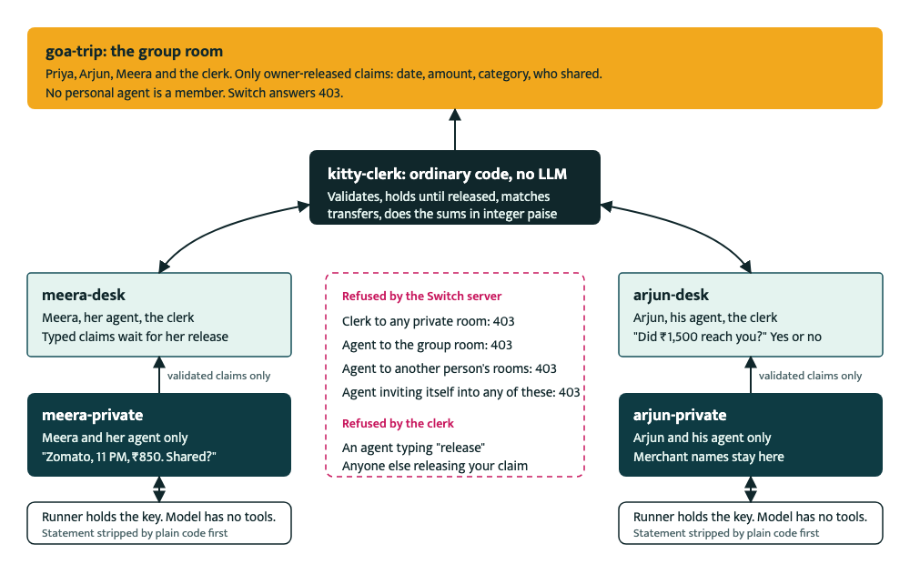

## Who does what

- **People** answer what only they know ("yes, but Meera had gone to bed"), release claims, and pay each other.
- **Personal agents** ([`kitty/agent.py`](kitty/agent.py)) sort statement lines and ask questions. The model behind each one has **no tools**: it can't post, read a file or reach Switch. It suggests, and plain code decides.
- **The clerk** ([`kitty/clerk.py`](kitty/clerk.py)) has no LLM. It validates claims, holds them until their owner releases them, matches transfers, and does the sums in integer paise.
- **`verify`** ([`scripts/verify.py`](scripts/verify.py)) proves the result without trusting the clerk's totals.

## Run it

**Tests, in under a minute, with no Switch and no model:**

```bash
uv sync
PYTHONPATH=. uv run pytest
```

**The whole stack.** You need Docker, [uv](https://docs.astral.sh/uv/) and [just](https://github.com/casey/just). Switch runs from source, beside this repository, at the commit we tested:

```bash
git clone https://github.com/sandbox-quantum/switch.git ../switch-src
git -C ../switch-src checkout fa933012b
cd ../switch-src
just init-env
just up
just migrate
just run
```

`just run` stays in the foreground.

**To make your own trip in the app,** in a second terminal, from this repository:

```bash
uv run python -m kitty.home_app
```

Then open <http://127.0.0.1:7000>. For the real model, install Claude Code and run `claude auth login` first. Put `KITTY_BRAIN=rules` before the command to run with no model at all. To watch all six people play through the routes the pages use, and then the independent check:

```bash
uv run python scripts/six_person.py
```

**For the original three-person demo,** the command-line route still works as it did:

```bash
uv run python scripts/setup_trip.py
uv run python scripts/run_all.py
```

Then open the demo stage at <http://127.0.0.1:7100/stage>. Add `KITTY_BRAIN=rules` before `run_all.py` to run with no model at all. For the real model, install Claude Code and run `claude auth login` first.

In a third terminal, you can play the people's side automatically and then check the outcome:

```bash
uv run python scripts/play_story.py
uv run python scripts/verify.py
```

Mattermost is at <http://localhost:8065>. Each person's login is in `state/<person>.json`.

| Tool | What it does |
|---|---|
| `kitty.home_app` | The app: create trips, follow set-up, hand out invites. Keeps each trip in `trips/<id>/` |
| `scripts/six_person.py` | Six scripted people, end to end, then `verify.py`. `--restart-midway` stops everything mid-trip. `--shots` saves stills |
| `scripts/rehearse_six.sh` | N six-person runs, stopping at the first failure |
| `scripts/usd_smoke.py` | A two-person trip in dollars, then `verify` |
| `scripts/setup_trip.py` | Command-line fallback: creates users, agents and rooms for the three-person demo. Run it again for a fresh trip |
| `scripts/run_all.py` | Runs the clerk, each agent and each person's app as separate processes |
| `scripts/play_story.py` | Scripted people, posting through their own Mattermost sessions |
| `scripts/demo_pay.py` | Adds one synthetic payment to two synthetic statements |
| `scripts/verify.py` | Checks the outcome |
| `scripts/eval_agent.py` | Scores the model against a hand-labelled answer key |
| `scripts/rehearse.sh` | N full runs from a fresh trip, stopping at the first failure |

## Results

These are real runs, and the output is in [`docs/evidence/`](docs/evidence/).

| Check | Result |
|---|---|
| Unit and scenario tests, no Switch, no model | 632 of 632 |
| **Pot trip:** six people, through the app's routes, no model (`pot_trip.py`) | Finished clean, `verify` 68 of 68, balances equal to the [hand-worked numbers](data/synthetic/pot/expected.md) |
| **Pot trip:** six people, real model | Finished clean, `verify` 68 of 68, same balances, no resends |
| **Pot trip:** every process stopped mid-collection, and a confirmation sent while they were down (`--restart-midway`) | Finished clean, `verify` 68 of 68. The confirmation kept the minute it was sent |
| **Pot trip:** confirming as a member, and as each agent, live (`--attack`) | All refused, `verify` 68 of 68 |
| **Pot trip:** planting a statement word, a reference and a broken chain in the group room (`--plant`) | `verify` fails each time, and names what was planted |
| **Pot trip:** a member typing a forged confirmation in the group room | Changes nobody's figures, and shows as that person's own message |
| Six people, real model, three runs in a row, created and played through the app's routes (`rehearse_six.sh`), and a fourth after a stack restart | 4 of 4 runs clean, `verify` 61 of 61 each time, balances equal to the [hand-worked numbers](data/synthetic/six/expected.md) each time |
| Two people, in dollars, real model (`usd_smoke.py`) | Finished clean, `verify` 28 of 28 |
| Six people again, with every process stopped mid-trip and a release sent while they were down (`--restart-midway`) | Finished clean, `verify` 61 of 61 |
| Isolation between owners (`gate1_spike.py`) | 28 of 28 |
| Real people in Mattermost (`gate1b_humans.py`) | 26 of 26 |
| Attacks on the live clerk, and a planted leak that verify must catch (`gate1d_release_live.py`) | 10 of 10 |
| Three-person story with the real model, three runs in a row, re-run after all of this (`rehearse.sh`, `verify.py`) | 3 of 3 runs clean, `verify` 37 of 37, balances identical each time |
| Model with no tools, under attack, with a positive control (`gate1c_llm_sandbox.py`) | 8 of 8 |
| Model against our answer key, 3 runs of 16 lines (`eval_agent.py`) | Latest 48 judgments: 39 correct decisions, 9 asked the person, 0 wrong. The first run scored 35, 13 and 0 |
| From fresh clones of both repos, following this README | Tests, setup, real-model story and verify all passed, about 3.5 minutes with Docker images and packages already cached |

The model score is a small sample on data we wrote and labelled ourselves, so it shows this demo works and says little about real statements. The model used is `claude-haiku-5-5`.

`verify` (37 checks for three people, 61 for six) confirms that balances recomputed from room text net to zero; every visible claim traces to a release by its owner's own account; 87 merchant words, refs and account numbers from the statements are absent from the group room and desks; the clerk is the only agent in the group room, as both Switch and Mattermost report it; the refusals are live 403s; a withdrawn payment isn't counted; and each confirmed payment was released by both people. On the six-person trip it also confirms that the same dinner claimed by two people counted once. Planting a merchant name in the group room makes it fail (60 of 61), which is the control for its "no leaks" result.

**In the six-person runs,** the model filed the rafting trip for all six, as it can't know Dev skipped it. The scripted person read the chit, dropped it, and said so, which is the product working as designed. Everything is on made-up data we wrote ourselves.

## What's real and what isn't

| Real | Synthetic or simplified |
|---|---|
| Switch server, room membership, sender ids | All the bank statements |
| Mattermost accounts and channels | The payments, which `demo_pay.py` adds to the statements |
| The clerk's rules and arithmetic | In `play_story.py` and `six_person.py`, the people are scripted, though they act through real accounts and real app routes |

## Limits

- **The interface has been checked in Chromium only,** with emulated touch and automated accessibility checks. It hasn't been tried in Safari or Firefox, on a real phone, or with a screen reader.

Read these before believing the tagline.

- **Statements still reach the model provider.** Plain code first strips balances, account numbers, references, lines outside the trip dates, incoming money and payments between friends. Merchant names and amounts of spending inside the trip are still sent. See [`docs/PRIVACY.md`](docs/PRIVACY.md).
- **Whoever hosts Switch can read private rooms.** On this stack, Mattermost's seeded `admin` and `user` accounts are members of every channel, private ones included. This suits friends who trust the host, and not parties who don't. There is no end-to-end encryption.
- **It runs on one laptop.** The processes are separate and hold separate credentials, but one OS user could read all of `state/`. Switch enforces room boundaries. The operating system doesn't enforce boundaries between these folders here.
- **No real banks.** CSV only, in one made-up format. The app refuses unmasked account columns and long digit runs and asks you to confirm the data is made up, but it can't tell whether a file is real. Don't upload real statements.
- **The home app has no login.** It trusts whoever can reach `127.0.0.1:7000` on this laptop, and it can see each unused invite link. An organiser could open someone's link first. That person would then find it already used, so it's detected and not prevented. The trip board has no login either. It shows only what the group room shows.
- **Mattermost's free edition stops at 250 active users.** Every person on every trip counts. After about 35 six-person trips on one server, new trips fail at the account step, and Mattermost's error names its safety limit. `just reset` clears it, along with everything else on that server.
- **Six people is the most we've run live,** and only on a set of statements we wrote. A trip allows up to twelve. Dollars have one live two-person run (`scripts/usd_smoke.py`, `verify` 28 of 28). Euros and pounds have no live run.
- **The roster is fixed once the group room opens.** There's no adding someone later, and no changing a split after release (see ADR-015).
- **A from-source Switch at a pinned commit**, which isn't the released product.
- **No user research.** Demand is unproven. The one number we found is a survey run by a company selling a split feature: [YouTrip, n=1,000](https://mustsharenews.com/singaporeans-fight-group-trip-expenses/), where 45% of those who front money say they spend over a day settling up.

## Related work

- [`martinvibes/airlock`](https://github.com/martinvibes/airlock), which showed that real multiple owners on one Mac work from source, and which informed our route. We read it to learn, and wrote our own code. Kitty is a different job: many-party settlement and two-sided confirmation.
- Splitwise, Tricount and Splid need someone to enter expenses. Splitwise Pro's and SplitterUp's imports bring one person's data into a shared app. Kitty keeps each person's data on their side and checks claims against each other.
- [Switch](https://github.com/sandbox-quantum/switch) is source-available under Apache 2.0 with the Commons Clause.

## More

- [`docs/BUILD_JOURNEY.md`](docs/BUILD_JOURNEY.md): what happened, in order, including what failed
- [`docs/DECISIONS.md`](docs/DECISIONS.md): the architecture decisions
- [`docs/PRIVACY.md`](docs/PRIVACY.md): exactly what goes where
